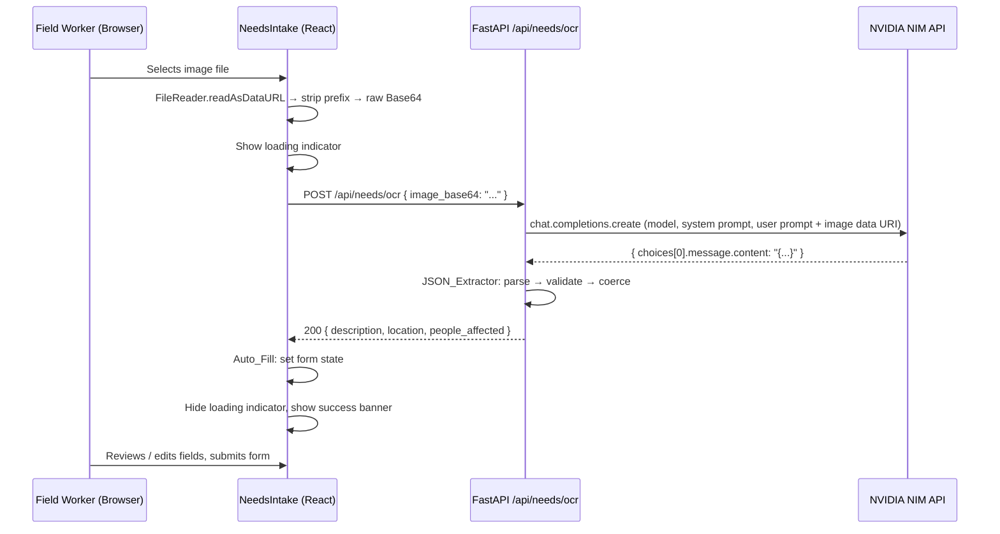

# Design Document — Vision AI OCR Pipeline

## Overview

The Vision AI OCR Pipeline adds real-image-based need reporting to SmartRelief. A field worker photographs or uploads an image of a handwritten or printed aid request form. The image is Base64-encoded in the browser, sent to a new FastAPI endpoint (`POST /api/needs/ocr`), and forwarded to the NVIDIA-hosted `meta/llama-3.2-90b-vision-instruct` vision language model via the OpenAI-compatible NIM API. The model returns a structured JSON object; the backend validates and normalises it, then returns it to the frontend, which auto-fills the NeedsIntake form fields. The feature is purely additive — the form remains fully functional without an image.

### Key Design Decisions

- **NVIDIA NIM over a self-hosted model**: The NIM API at `https://integrate.api.nvidia.com/v1` exposes an OpenAI-compatible interface, so the existing `openai` Python package is the only new backend dependency. No GPU infrastructure is required.
- **Base64 over multipart upload**: The frontend already uses JSON for all API calls. Sending the image as a Base64 string in a JSON body keeps the transport layer consistent and avoids CORS complexity with multipart forms.
- **Synchronous (non-streaming) LLM call**: OCR extraction is a single-shot structured-output task. Streaming adds complexity with no benefit here.
- **Regex fallback extraction**: Vision LLMs occasionally wrap JSON in markdown fences or prose. A `{...}` substring extractor handles this gracefully before returning a 422.
- **Frontend-only state management**: Auto-fill calls the existing React `useState` setters directly. No new global state, context, or store is introduced.

---

## Architecture



### Component Boundaries

| Layer | Component | Responsibility |
|---|---|---|
| Frontend | `Upload_Zone` (inside `NeedsIntake.jsx`) | Image capture UI, thumbnail preview, loading/error states |
| Frontend | `Base64_Encoder` (inline FileReader logic) | Convert `File` → raw Base64 string |
| Frontend | `Auto_Fill` (inline state-setter calls) | Map OCR response fields to form state |
| Backend | `OCR_Endpoint` (`POST /api/needs/ocr` in `main.py`) | Receive Base64, call Vision LLM, return structured data |
| Backend | `JSON_Extractor` (helper function in `main.py`) | Parse, fallback-extract, validate, and coerce LLM output |
| External | NVIDIA NIM API | Run `meta/llama-3.2-90b-vision-instruct` inference |

---

## Components and Interfaces

### Frontend: Upload_Zone

Replaces the existing mock OCR drop zone in `NeedsIntake.jsx`. The component renders a styled, clickable area that wraps a hidden `<input type="file">`.

**HTML attributes on the file input:**
```html
<input type="file" accept="image/*" capture="environment" />
```

`capture="environment"` activates the rear camera on mobile; on desktop it falls back to the standard file picker.

**States:**
- `idle` — initial state, shows camera/upload icon and labels
- `scanning` — OCR request in flight, shows spinner and "Extracting details…" text
- `done` — OCR succeeded, shows checkmark and success banner
- `error` — OCR failed, shows inline error message inside the zone

**Thumbnail preview:** When a file is selected, a `` element is rendered inside the zone using `URL.createObjectURL(file)` for an instant preview before the OCR response arrives.

### Frontend: Base64_Encoder

Inline `FileReader` logic triggered by the `onChange` handler of the file input:

```js
const encodeToBase64 = (file) =>
  new Promise((resolve, reject) => {
    const reader = new FileReader();
    reader.onload = () => {
      // Strip "data:<mime>;base64," prefix
      const raw = reader.result.split(',')[1];
      resolve(raw);
    };
    reader.onerror = reject;
    reader.readAsDataURL(file);
  });
```

The raw Base64 string (no prefix) is passed directly to the OCR fetch call.

### Frontend: OCR Fetch and Auto_Fill

```js
const handleFileChange = async (e) => {
  const file = e.target.files?.[0];
  if (!file) return;
  setPreviewUrl(URL.createObjectURL(file));
  setOcrState('scanning');
  try {
    const base64 = await encodeToBase64(file);
    const res = await fetch('http://localhost:8000/api/needs/ocr', {
      method: 'POST',
      headers: { 'Content-Type': 'application/json' },
      body: JSON.stringify({ image_base64: base64 }),
    });
    if (res.ok) {
      const data = await res.json();
      // Auto_Fill: call existing state setters
      if (data.description) setForm(f => ({ ...f, needs_description: data.description }));
      if (data.location)    setForm(f => ({ ...f, location: data.location }));
      if (data.people_affected > 0)
        setForm(f => ({ ...f, estimated_people_affected: String(data.people_affected) }));
      setOcrState('done');
    } else {
      setOcrState('error');
    }
  } catch {
    setOcrState('error');
  }
};
```

A new `previewUrl` state variable holds the object URL for the thumbnail. A new `ocrState` state variable (`'idle' | 'scanning' | 'done' | 'error'`) drives the Upload_Zone rendering.

### Backend: OCR_Endpoint

New route added to `backend/main.py`:

```python
POST /api/needs/ocr
Content-Type: application/json
Body: { "image_base64": "<raw base64 string>" }

Response 200: { "description": str, "location": str, "people_affected": int }
Response 422: { "detail": "OCR extraction failed to produce valid JSON", "raw_response": str }
Response 503: { "detail": "NVIDIA_API_KEY is not configured." }
```

**Pydantic schemas** (added to `schemas.py`):

```python
class OCRRequest(BaseModel):
    image_base64: str = Field(..., min_length=1)

class OCRResponse(BaseModel):
    description: str
    location: str
    people_affected: int
```

### Backend: JSON_Extractor

A pure helper function that takes the raw LLM response string and returns a validated `OCRResponse` or raises a structured error:

```python
def extract_ocr_json(raw: str) -> dict:
    # Attempt 1: direct parse
    try:
        return json.loads(raw)
    except json.JSONDecodeError:
        pass
    # Attempt 2: substring extraction
    start = raw.find('{')
    end = raw.rfind('}')
    if start != -1 and end != -1 and end > start:
        try:
            return json.loads(raw[start:end + 1])
        except json.JSONDecodeError:
            pass
    raise ValueError(raw)  # caller converts to 422
```

After extraction, the endpoint validates required keys and coerces `people_affected` to `int` if it arrives as a string.

---

## Data Models

### OCRRequest (Pydantic — `schemas.py`)

| Field | Type | Constraints | Description |
|---|---|---|---|
| `image_base64` | `str` | `min_length=1` | Raw Base64-encoded image, no data URL prefix |

### OCRResponse (Pydantic — `schemas.py`)

| Field | Type | Description |
|---|---|---|
| `description` | `str` | Full extracted text describing the humanitarian need |
| `location` | `str` | Extracted or inferred location; empty string if not found |
| `people_affected` | `int` | Number of people affected; 0 if not determinable |

### Frontend Form State (additions to `NeedsIntake.jsx`)

| State variable | Type | Purpose |
|---|---|---|
| `ocrState` | `'idle' \| 'scanning' \| 'done' \| 'error'` | Drives Upload_Zone rendering |
| `previewUrl` | `string \| null` | Object URL for thumbnail preview |

No new database collections or Firestore documents are introduced. The OCR pipeline is stateless — it transforms an image into form field values and returns them to the client. Persistence happens through the existing `POST /api/needs` flow after the user submits the form.

---

## Correctness Properties

*A property is a characteristic or behavior that should hold true across all valid executions of a system — essentially, a formal statement about what the system should do. Properties serve as the bridge between human-readable specifications and machine-verifiable correctness guarantees.*

### Property 1: Base64 encoding strips the data URL prefix

*For any* file with any binary content, the `Base64_Encoder` output SHALL be a valid Base64 string that contains no `data:` prefix substring.

**Validates: Requirements 1.4**

---

### Property 2: JSON_Extractor accepts any valid schema-conforming JSON

*For any* string that is valid JSON and contains all three required keys (`description` as a string, `location` as a string, `people_affected` as an integer or integer-string), the `JSON_Extractor` SHALL successfully return a parsed object with all three keys present and `people_affected` as an integer.

**Validates: Requirements 3.2, 3.4, 3.7, 3.8**

---

### Property 3: JSON_Extractor recovers embedded JSON from surrounding text

*For any* valid schema-conforming JSON object wrapped in arbitrary surrounding text (preamble, postamble, or markdown fences), the `JSON_Extractor` SHALL extract and return the correct object.

**Validates: Requirements 3.5**

---

### Property 4: JSON_Extractor rejects objects missing required keys

*For any* JSON object that is missing one or more of the three required keys (`description`, `location`, `people_affected`), the `JSON_Extractor` SHALL raise a validation error rather than returning a partial object.

**Validates: Requirements 3.7**

---

### Property 5: Auto_Fill maps all non-zero OCR fields to form state

*For any* OCR response where `description` is non-empty, `location` is non-empty, and `people_affected` is greater than 0, after `Auto_Fill` executes, the form state SHALL have `needs_description` equal to `description`, `location` equal to `location`, and `estimated_people_affected` equal to the string representation of `people_affected`.

**Validates: Requirements 4.1, 4.2, 4.3**

---

### Property 6: Form state is preserved on OCR error

*For any* pre-existing form state (any combination of field values), when the OCR endpoint returns an error response, all form field values SHALL remain unchanged after the error is handled.

**Validates: Requirements 4.9**

---

## Error Handling

| Scenario | Backend behaviour | Frontend behaviour |
|---|---|---|
| `NVIDIA_API_KEY` not set | Return HTTP 503 `{"detail": "NVIDIA_API_KEY is not configured."}` | Show inline error in Upload_Zone: "Could not extract text from this image — please fill in the details manually" |
| LLM returns unparseable text | Return HTTP 422 `{"detail": "OCR extraction failed to produce valid JSON", "raw_response": "..."}` | Same inline error message |
| LLM returns JSON missing required keys | Return HTTP 422 `{"detail": "OCR response missing required fields."}` | Same inline error message |
| Network error / timeout | N/A (request never reaches backend) | `catch` block sets `ocrState = 'error'`, shows inline error |
| New image selected while scanning | N/A | Previous `ocrState` is reset to `'scanning'`, new OCR request starts; if the previous fetch resolves after the new one starts, its result is discarded (stale-closure guard via a `requestId` ref) |
| Image too large (browser-side) | N/A | No hard limit enforced in v1; the browser FileReader handles arbitrarily large files. A future enhancement could add a client-side size check. |
| Backend returns 200 but `people_affected` is 0 | Return 200 with `people_affected: 0` | `estimated_people_affected` field is left empty (not set to "0") |

### Stale Request Guard

To handle rapid image re-selection (Requirement 1.8), a `requestIdRef` is used:

```js
const requestIdRef = useRef(0);

const handleFileChange = async (e) => {
  const myId = ++requestIdRef.current;
  // ... encode, fetch ...
  if (requestIdRef.current !== myId) return; // stale — discard
  // ... apply auto-fill ...
};
```

This ensures only the most recently initiated OCR request can update form state.

---

## Testing Strategy

### Unit Tests (pytest — `backend/tests/`)

Focus on the pure logic layer: `JSON_Extractor` and the Pydantic schema validation.

- **Happy path**: valid JSON string → correct `OCRResponse` object
- **Fallback extraction**: JSON wrapped in markdown fences → correct extraction
- **Missing key rejection**: JSON missing `description`, `location`, or `people_affected` → `ValueError`
- **Type coercion**: `people_affected` as `"42"` → `42` (int)
- **503 guard**: endpoint called with `NVIDIA_API_KEY=""` → HTTP 503
- **422 guard**: endpoint called with unparseable LLM output → HTTP 422

### Property-Based Tests (pytest + Hypothesis — `backend/tests/`)

The project uses Python/FastAPI, so [Hypothesis](https://hypothesis.readthedocs.io/) is the appropriate property-based testing library. Each property test runs a minimum of 100 iterations.

**Property 1 — Base64 encoding strips the data URL prefix**
```python
# Feature: vision-ai-ocr-pipeline, Property 1: Base64 encoding strips the data URL prefix
@given(st.binary(min_size=1))
@settings(max_examples=100)
def test_base64_no_prefix(content):
    # Simulate FileReader.readAsDataURL output then strip
    data_url = "data:image/jpeg;base64," + base64.b64encode(content).decode()
    raw = data_url.split(',')[1]
    assert 'data:' not in raw
    assert base64.b64decode(raw) == content
```

**Property 2 — JSON_Extractor accepts any valid schema-conforming JSON**
```python
# Feature: vision-ai-ocr-pipeline, Property 2: JSON_Extractor accepts any valid schema-conforming JSON
@given(
    description=st.text(min_size=0),
    location=st.text(min_size=0),
    people_affected=st.integers(min_value=0, max_value=1_000_000),
)
@settings(max_examples=100)
def test_extractor_accepts_valid_json(description, location, people_affected):
    raw = json.dumps({"description": description, "location": location, "people_affected": people_affected})
    result = extract_ocr_json(raw)
    assert result["description"] == description
    assert result["location"] == location
    assert isinstance(result["people_affected"], int)
```

**Property 3 — JSON_Extractor recovers embedded JSON from surrounding text**
```python
# Feature: vision-ai-ocr-pipeline, Property 3: JSON_Extractor recovers embedded JSON from surrounding text
@given(
    prefix=st.text(alphabet=st.characters(blacklist_characters='{}'), max_size=50),
    suffix=st.text(alphabet=st.characters(blacklist_characters='{}'), max_size=50),
    description=st.text(min_size=0),
    location=st.text(min_size=0),
    people_affected=st.integers(min_value=0),
)
@settings(max_examples=100)
def test_extractor_recovers_embedded_json(prefix, suffix, description, location, people_affected):
    inner = json.dumps({"description": description, "location": location, "people_affected": people_affected})
    wrapped = prefix + inner + suffix
    result = extract_ocr_json(wrapped)
    assert result["description"] == description
```

**Property 4 — JSON_Extractor rejects objects missing required keys**
```python
# Feature: vision-ai-ocr-pipeline, Property 4: JSON_Extractor rejects objects missing required keys
@given(st.sets(st.sampled_from(["description", "location", "people_affected"]), min_size=1, max_size=2))
@settings(max_examples=100)
def test_extractor_rejects_missing_keys(missing_keys):
    obj = {"description": "text", "location": "city", "people_affected": 10}
    for k in missing_keys:
        del obj[k]
    with pytest.raises((ValueError, KeyError)):
        validate_ocr_fields(json.dumps(obj))
```

**Property 5 — Auto_Fill maps all non-zero OCR fields to form state**

This property tests the pure mapping logic extracted from the React component. In a Jest/Vitest test environment:
```js
// Feature: vision-ai-ocr-pipeline, Property 5: Auto_Fill maps all non-zero OCR fields to form state
test.prop([fc.record({
  description: fc.string({ minLength: 1 }),
  location: fc.string({ minLength: 1 }),
  people_affected: fc.integer({ min: 1, max: 1_000_000 }),
})])('auto-fill maps all fields', (ocrResponse) => {
  const { result } = renderHook(() => useState(EMPTY_FORM));
  applyAutoFill(result.current[1], ocrResponse);
  expect(result.current[0].needs_description).toBe(ocrResponse.description);
  expect(result.current[0].location).toBe(ocrResponse.location);
  expect(result.current[0].estimated_people_affected).toBe(String(ocrResponse.people_affected));
});
```

**Property 6 — Form state is preserved on OCR error**
```js
// Feature: vision-ai-ocr-pipeline, Property 6: Form state is preserved on OCR error
test.prop([fc.record({
  reporter_name: fc.string(),
  location: fc.string(),
  needs_description: fc.string(),
  estimated_people_affected: fc.string(),
  contact_email: fc.string(),
})])('form state unchanged on OCR error', (initialForm) => {
  const { result } = renderHook(() => useState(initialForm));
  handleOcrError(result.current[1], initialForm);
  expect(result.current[0]).toEqual(initialForm);
});
```

### Integration Tests

- End-to-end: POST `/api/needs/ocr` with a real small test image and a valid `NVIDIA_API_KEY` → assert HTTP 200 and all three fields present (run in CI only when `NVIDIA_API_KEY` is set)
- 503 guard: POST `/api/needs/ocr` with `NVIDIA_API_KEY` unset → assert HTTP 503
- 422 guard: POST `/api/needs/ocr` with a mocked LLM returning `"not json"` → assert HTTP 422

### Frontend Component Tests (Vitest + React Testing Library)

- Render `NeedsIntake` → assert file input has `accept="image/*"` and `capture="environment"`
- Simulate file selection → assert thumbnail `` appears
- Mock successful OCR fetch → assert form fields are populated and success banner is visible
- Mock failed OCR fetch → assert error message appears inside Upload_Zone
- Assert all auto-filled fields remain editable (not `readOnly`)
